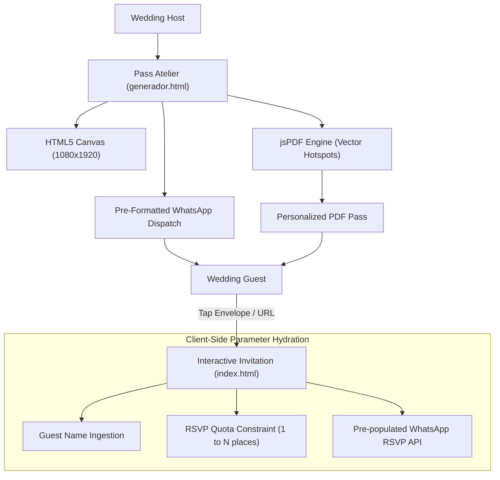

# Wedding Atelier & Interactive Invitation

**High-fidelity client-side wedding invitation suite with dynamic guest seat quotas and interactive PDF pass generation.**

<kbd>HTML5 Canvas</kbd> &nbsp; <kbd>jsPDF Vector Engine</kbd> &nbsp; <kbd>Zero-Backend</kbd> &nbsp; <kbd>GitHub Pages Ready</kbd>

<br />

[Overview](#-overview) &nbsp;•&nbsp;
[Key Features](#-key-features) &nbsp;•&nbsp;
[Architecture & Data Flow](#-architecture--stack) &nbsp;•&nbsp;
[Dynamic Parameter Protocol](#-dynamic-parameter-protocol) &nbsp;•&nbsp;
[Quickstart](#-quickstart)

---

> [!IMPORTANT]
> **Traditional digital wedding invitations suffer from severe structural friction:**  
> Static PDFs cannot enforce personalized seat quotas, proprietary SaaS platforms lock guest data behind subscription paywalls and intrusive third-party ads, and dynamic backend services incur ongoing maintenance costs.  
> This repository implements a **100% zero-backend, client-side stationery atelier** capable of generating high-DPI interactive PDFs with embedded mobile hotspots, dynamic URL parameter hydration, and zero server maintenance on GitHub Pages.

---

## ↳ Overview

**Wedding Atelier** is an integrated two-part wedding stationery and RSVP ecosystem designed for the wedding of **Miguel Ángel & Karen Neptaly**:

1. **Interactive Web Invitation (`index.html`):** A responsive, typography-driven digital invitation featuring an ambient soundtrack (*Hasta El Fin* by Majo y Dan), transparent gold botanical timeline icons, real-time Google Maps ceremony coordinates, and an RSVP section dynamically constrained by URL parameters.
2. **Stationery Pass Generator (`generador.html`):** A client-side desktop atelier that renders 1080×1920 high-resolution guest passes on an HTML5 Canvas, generates vector-linked PDFs with clickable hotspots (web invitation, church map, WhatsApp RSVP), and outputs pre-composed WhatsApp dispatch messages.

### 🛡️ Core Capabilities

- [x] **Zero-Backend Architecture:** 100% client-side execution running on vanilla JavaScript and GitHub Pages with zero database or server runtime dependencies.
- [x] **Dynamic Quota Ingestion:** URL parameters (`?invitado=...&pases=...`) dynamically customize the greeting and strictly cap the RSVP attendance dropdown to prevent overbooking.
- [x] **Interactive PDF Hotspots:** Generates high-DPI printable PDF passes containing three embedded vector link annotations (`/URI` hotspots for web invite, Google Maps, and direct WhatsApp confirmation).
- [x] **Fine Stationery Aesthetic:** Forest green (`#244738`) and antique gold (`#8C7355`) palette paired with classical typography (*Cinzel*, *Cormorant Garamond*, *Baskerville*) and real gold wax seal monograms.
- [x] **Privacy & Persistence:** Host data and generated pass histories remain strictly in client `localStorage` with zero telemetry or third-party tracking.

---

## ↳ Architecture & Stack



```text
boda-miguel-karen/
├── dist/
│   ├── index.html                   # Production interactive web invitation
│   ├── generador.html               # Pass generator atelier (Canvas + jsPDF)
│   ├── jspdf.umd.min.js             # Standalone PDF generation library
│   ├── template_base64.js           # Embedded stationery artwork assets
│   ├── monograma_km_gold.png        # Official wax seal monogram
│   ├── foto_mano_anillo.jpg         # High-resolution hero photography
│   ├── musica_boda.m4a              # Ambient audio track (Hasta El Fin)
│   ├── iconocolordorado*.png        # Bespoke gold botanical itinerary icons
│   └── Pase_Boda_Karen_y_Miguel_FINAL.pdf # Reference high-DPI output pass
├── README.md                        # Technical documentation & architecture
└── LICENSE                          # MIT open source license
```

---

## ↳ Dynamic Parameter Protocol

The web invitation dynamically adapts its typography, seat allocation, and RSVP form choices through query string parameters:

```diff
# Target: dist/index.html RSVP Controller
- <option value="1">1 persona</option>
- <option value="2">2 personas</option>
- <option value="3">3 personas</option>
- <option value="4">4 personas</option>
+ // Injected dynamically based on URL ?pases=2
+ <option value="1">1 persona (Asistiré)</option>
+ <option value="2">2 personas (Asistiremos ambos)</option>
+ // Options > 2 are strictly pruned to enforce assigned quota
```

<details>
<summary><b>📄 Click to view URL Parameter Specification</b></summary>

<br />

| Parameter | Type | Required | Description | Example |
| :--- | :--- | :--- | :--- | :--- |
| `invitado` | `string` | Optional | Full guest name or family greeting | `Familia+González+López` |
| `pases` | `integer` | Required | Strict maximum honor seats reserved | `2` |
| `tel` | `string` | Optional | WhatsApp contact recipient phone number | `525511926599` |

**Full Sample URL:**
```text
https://username.github.io/boda/?invitado=Sra.+Lorena+Ch%C3%A1vez+y+Esposo&pases=2
```

</details>

---

## ↳ Quickstart

### Prerequisites
* Any modern web browser (Safari, Chrome, Firefox, Edge).
* Zero external package dependencies (`npm` or `node` not required).

### Local Execution
To inspect or generate passes locally:

```bash
# Clone the repository
git clone https://github.com/josiasemm/boda-miguel-karen.git
cd boda-miguel-karen/dist

# Serve locally to test both HTTP audio autoplay policies and PDF link sandboxes
python3 -m http.server 8080
```

Navigate to:
* **Pass Atelier:** `http://localhost:8080/generador.html`
* **Web Invitation:** `http://localhost:8080/index.html?invitado=Invitado+Especial&pases=2`

### GitHub Pages Deployment
1. Go to repository **Settings** → **Pages**.
2. Select **Source**: `Deploy from a branch`.
3. Select **Branch**: `main` (or `dist` folder) and `/root`.
4. Your invitation is live at `https://<username>.github.io/<repo>/` with native mobile PDF tapping enabled out of the box.

> [!TIP]
> **Mobile OS Sandbox Immunity:**  
> When deployed to GitHub Pages over `https://`, all mobile PDF readers (Apple iOS Preview, Android PDF Viewer, Adobe Reader) treat the embedded envelope `/URI` link as a verified web target, opening the invitation in Safari/Chrome with a single tap.

---

## ↳ License

Distributed under the MIT License. See [LICENSE](LICENSE) for details.

<br />

<div align="center">
  
</div>
